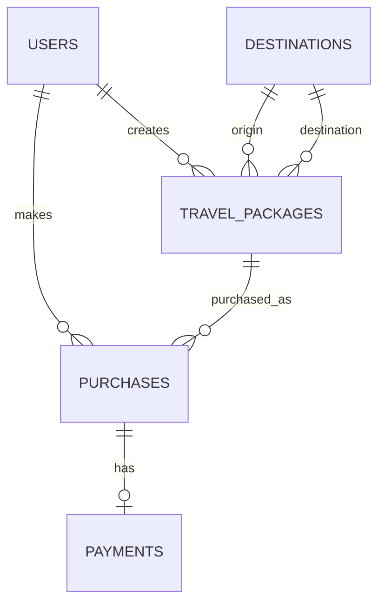

# Modelo de dados — Travel API

## Decisões

- `Destination` representa uma localidade e pode ser usada como origem ou destino.
- `TravelPackage` representa uma oferta específica: origem, destino, período, preço e capacidade.
- `Purchase` guarda snapshots do período e dos valores contratados. Alterar um pacote depois da compra não altera o histórico.
- `Payment` é separado de `Purchase` para manter o ciclo de pagamento independente. O projeto simula cartão e não persiste número do cartão nem CVV.
- Usuários têm papel `CLIENT` ou `ADMIN`. O cadastro público sempre deverá criar `CLIENT`; criação de `ADMIN` será feita somente por outro administrador.
- Pacotes e destinos devem ser desativados (`is_active = false`) em vez de excluídos quando já tiverem histórico associado.
- Os valores monetários usam `NUMERIC(12, 2)` / `Decimal`, nunca `float`.

## Relacionamentos

## Regras reforçadas no PostgreSQL

- CPF possui 11 dígitos e é único.
- E-mail possui índice único case-insensitive (`lower(email)`).
- Origem e destino de um pacote devem ser diferentes.
- Retorno deve ser posterior à partida.
- Preço e custo não podem ser negativos.
- Vagas disponíveis ficam entre zero e a capacidade total.
- Quantidade comprada deve ser positiva.
- Um pagamento está associado a no máximo uma compra.
- Uma compra não pode ter período sobreposto a outra compra confirmada/concluída do mesmo cliente. A constraint `EXCLUDE USING gist` utiliza `daterange(..., '[]')`, portanto as datas de ida e volta são inclusivas. A extensão `btree_gist` fornece o operador GiST para UUID.

## Observações de implementação

A constraint de sobreposição protege a integridade mesmo em requisições concorrentes. O `PurchaseService` também deverá consultar conflitos para devolver uma mensagem amigável antes de tentar inserir. A constraint permanece como última linha de defesa.

`available_seats` será decrementado dentro da mesma transação da compra, após bloquear o registro do pacote com `SELECT ... FOR UPDATE`. O `cost_amount` da compra é o snapshot do custo unitário multiplicado pela quantidade; `total_amount` é o snapshot do preço unitário multiplicado pela quantidade.

## Status iniciais

- Usuário: `CLIENT`, `ADMIN`.
- Compra: `PENDING`, `CONFIRMED`, `CANCELLED`, `COMPLETED`.
- Pagamento: `PENDING`, `APPROVED`, `DECLINED`, `REFUNDED`.
- Meio de pagamento simulado: `CREDIT_CARD`.

Somente compras `CONFIRMED` e `COMPLETED` bloqueiam o período na constraint. Ao cancelar/refundar uma compra, o fluxo de negócio deverá atualizar o status e restaurar vagas na mesma transação.
